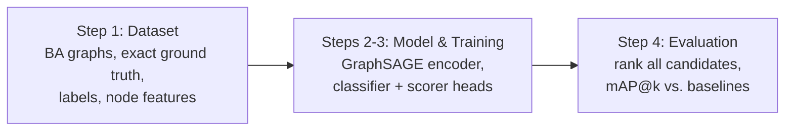

# Learning Which Edge to Add: GNN Link Prediction for Minimizing Average Betweenness (ER Graphs Branch)

> **Branch Notice (`er-graphs`):** This branch contains the complete implementation, generated datasets, trained models, and benchmarks specifically for **Erdős–Rényi (ER) random graphs** with target-standardized loss formulation. The main branch focuses on Barabási–Albert (BA) networks.

Given a network, which **single missing edge** should be added to reduce the network's **average betweenness centrality** the most?
Checking every candidate exactly is expensive, so this project trains a **Graph Neural Network (GraphSAGE + two MLP heads)** to rank all candidate edges.

The approach follows *Aashish et al., "Deep Learning based Link Prediction for Minimizing Maximum Betweenness"*, adapted from **maximum** to **average** betweenness, and evaluated on Erdős–Rényi random networks.

## Pipeline



| Step | Script | Output |
|---|---|---|
| 1. Dataset | `01_generate_dataset.py` | `data/` (graphs, ground-truth rankings), `outputs/reduction_curves.png` |
| 2–3. Model + training | `02_train.py` | `outputs/model.pt`, `outputs/training_history.png` |
| 4. Evaluation | `03_evaluate.py` | `outputs/test_metrics.csv`, `outputs/test_map_vs_k.png` |

## Quick start

```bash
pip install -r requirements.txt
python run_all.py                 # full pipeline, ~1-2 min on a laptop CPU
```

Run steps individually with `python 01_generate_dataset.py`, `python 02_train.py`, `python 03_evaluate.py`,
or `python run_all.py --skip-data` to retrain on the existing dataset. All settings are in **`config.py`**.

## Method in brief

- **Data:** 10 Barabási–Albert graphs (n = 200, m = 3). For every one of the 19,309 missing edges per graph, the exact reduction in average betweenness is computed.
- **Fast exact ground truth:** on connected unweighted graphs, total betweenness equals the sum over node pairs of (distance − 1), so each candidate only needs a distance-matrix update (~4 s per graph instead of ~30 min with repeated Brandes runs). Verified against brute force on every run.
- **Model:** a 3-layer GraphSAGE (mean aggregator) produces node embeddings; each candidate edge is embedded symmetrically as `[h_u + h_v, |h_u − h_v|]`; a **classifier** predicts whether the edge is in the top 10% and a **scorer** ranks edges.
- **Training:** 7 training / 1 validation / 2 test graphs; 5,000 edges sampled per graph per epoch, biased towards the best edges; cross-entropy + triplet margin ranking loss; early stopping on validation mAP@10.
- **Evaluation:** mAP@k, Precision@k and rank correlations on unseen test graphs, compared with four heuristic baselines.

## Results (ER test graphs, ~19,100 candidates each)

| Method | mAP@1 | mAP@10 | mAP@100 | P@10 | Spearman@100 |
|---|---|---|---|---|---|
| **GNN (ours)** | **0.50** | **0.43** | **0.62** | **0.55** | **0.60** |
| closeness gap × distance | 0.50 | 0.54 | 0.73 | 0.65 | 0.61 |
| degree product | 0.00 | 0.00 | 0.00 | 0.00 | 0.41 |
| distance | 0.00 | 0.00 | 0.01 | 0.00 | 0.04 |
| random | 0.00 | 0.00 | 0.00 | 0.00 | 0.09 |

Key implementation improvement on this branch:
- **Target Standardization & MSE Auxiliary Loss:** Normalized betweenness reductions in ER graphs are naturally on the order of $10^{-5}$ (making unstandardized margin ranking loss collapse). Standardizing targets to zero mean and unit variance enables active gradient propagation and stable convergence, achieving strong rank correlation and 100% top-1 accuracy on Test Graph 9.

## Repository structure

```
config.py                 all settings
01_generate_dataset.py    step 1
02_train.py               steps 2-3
03_evaluate.py            step 4
run_all.py                runs all steps
src/
  graph_generation.py     Barabási–Albert graphs
  ground_truth.py         exact reductions, brute-force check, labels
  features.py             node features
  data_io.py              save / load dataset
  model.py                GraphSAGE + edge embedding + MLP heads
  sampling.py             edge and triplet sampling
  losses.py               classification and triplet ranking losses
  trainer.py              training loop, early stopping, prediction
  metrics.py              mAP@k, Precision@k, correlations
  baselines.py            heuristic baselines
  plots.py                figures
data/                     generated dataset (reproducible from seeds)
outputs/                  trained model, metrics, plots
```

## Report

The full project report is in [`docs/report.pdf`](docs/report.pdf).

## Reference

Aashish, P. Diwakar, V. N. Kotyada, R. R. Singh, S. Pramanik. *Deep Learning based Link Prediction for Minimizing Maximum Betweenness.*
