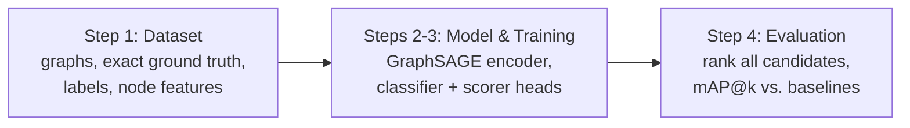

# Learning Which Edge to Add: GNN Link Prediction for Minimizing Average Betweenness

Given a network, which **single missing edge** should be added to reduce the network's **average betweenness centrality** the most?
Checking every candidate exactly is expensive, so this project trains a **Graph Neural Network (GraphSAGE + two MLP heads)** to rank all candidate edges.

The approach follows *Aashish et al., "Deep Learning based Link Prediction for Minimizing Maximum Betweenness"*, adapted from **maximum** to **average** betweenness.

## Pipeline



| Step | Script | Output |
|---|---|---|
| 1. Dataset | `01_generate_dataset.py` | `data/` (graphs, ground-truth rankings), `outputs/reduction_curves.png` |
| 2–3. Model + training | `02_train.py` | `outputs/model.pt`, `outputs/training_history.png` |
| 4. Evaluation | `03_evaluate.py` | `outputs/test_metrics.csv`, `outputs/test_map_vs_k.png` |

## Quick start

```bash
pip install -r requirements.txt
python run_all.py                 # full pipeline (20 graphs), ~6-8 min on a laptop CPU
```

Run steps individually with `python 01_generate_dataset.py`, `python 02_train.py`, `python 03_evaluate.py`,
or `python run_all.py --skip-data` to retrain on the existing dataset. All settings are in **`config.py`**.
Every option is a switch there; the defaults are the best combination found in the experiments.

## Method in brief (current best pipeline)

- **Data:** 20 Barabási–Albert graphs (n = 200, m = 3), split 14 train / 2 validation / 4 test.
  - For every one of the 19,309 missing edges per graph, the exact reduction in average betweenness is computed.
  - Other graph types are available via `graph_type`: `er`, `random_tree`, `ktree`, `path`.
- **Fast exact ground truth:**
  - On connected unweighted graphs, total betweenness = sum over node pairs of (distance − 1).
  - So each candidate only needs a distance-matrix update (~5 s per graph instead of ~30 min).
  - Verified against brute force on every run.
- **Labels:** 3 classes (top 2% / 2–10% / rest). Ties share a rank (1, 1, 3, …).
- **Model:**
  - 3-layer GraphSAGE on 4 structural node features (degree, clustering, closeness, core number).
  - Edge vector `[h_u + h_v, |h_u − h_v|]` plus 7 hand-made edge features: distance, common neighbours, Jaccard, Adamic–Adar, closeness gap, and min/max closeness and degree.
  - A classifier head and a ranking head.
- **Training:**
  - Two stages: first the GNN + classifier, then the whole model is fine-tuned on the ranking loss at a lower learning rate.
  - 5,000 edges sampled per graph per epoch, biased to the top, in mini-batches of 500.
  - Triplet margin loss on good edges.
  - Early stopping on the mean of validation mAP@10 and mAP@50.
- **Shortlist + exact:** the model's top 200 edges are re-scored with the exact method. This costs almost nothing and gives near-perfect top-50 lists.

## Results (4 unseen test graphs, mean of 5 training seeds)

| Method | mAP@10 | mAP@50 | top-50 overlap |
|---|---|---|---|
| **GNN + exact re-scoring of its top 200** | **0.975** | **0.970** | **0.970** |
| **GNN (current pipeline)** | **0.538** | **0.662** | **0.719** |
| GNN (original pipeline) | 0.449 | 0.553 | 0.636 |
| closeness gap × distance (best heuristic) | 0.271 | 0.385 | 0.450 |
| degree product | 0.013 | 0.023 | 0.086 |
| distance / random | 0.000 | 0.000 | 0.000 |

- **Bigger graphs:** the model trained on 200-node graphs still works on 500-node graphs (mAP@10 0.546). With exact re-scoring of its top 500 it reaches 0.975, in ~1 s instead of minutes.
- **Full log:** every experiment (38 configurations, one change at a time) is in [`experiments/RESULTS.md`](experiments/RESULTS.md).

## Repository structure

```
config.py                 all settings
01_generate_dataset.py    step 1
02_train.py               steps 2-3
03_evaluate.py            step 4
run_all.py                runs all steps
src/
  graph_generation.py     BA, ER, random tree, k-tree, path graphs
  ground_truth.py         exact reductions, brute-force check, labels, exact re-scoring
  features.py             node and edge features
  data_io.py              save / load dataset
  model.py                GraphSAGE + edge embedding + MLP heads
  sampling.py             edge and triplet sampling
  losses.py               classification and triplet ranking losses
  trainer.py              training loop, early stopping, prediction
  metrics.py              mAP@k, Precision@k, correlations
  baselines.py            heuristic baselines
  plots.py                figures
data/                     generated dataset (reproducible from seeds)
outputs/                  trained model, metrics, plots
experiments/              experiment harness, all run results, RESULTS.md
```

## Report

The full project report is in [`docs/report.pdf`](docs/report.pdf).

## Reference

Aashish, P. Diwakar, V. N. Kotyada, R. R. Singh, S. Pramanik. *Deep Learning based Link Prediction for Minimizing Maximum Betweenness.*
